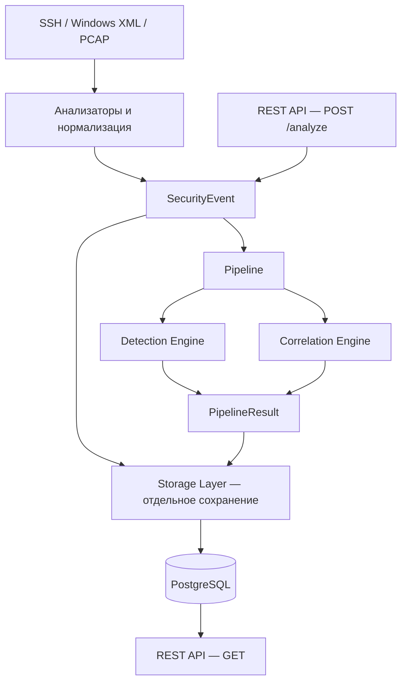

# Security Detection Engine


Локальный MVP для нормализации и пакетного анализа событий безопасности.
SSH-журналы, Windows XML и сохранённые PCAP преобразуются в SecurityEvent.
Detection Engine проверяет отдельные события по YAML-правилам, Correlation
Engine ищет последовательности событий во временном окне.

Результаты можно сохранять в PostgreSQL и читать через REST API.
API принимает нормализованные события. Файловые анализаторы доступны через Python.
Версия проекта — 0.1.0.

## Возможности и устройство

Реализованы Linux SSH Analyzer, Windows Event Log XML Analyzer, Network PCAP
Analyzer, общая модель `SecurityEvent`, оба движка, Unified Pipeline,
транзакционное хранение PostgreSQL, REST API и развёртывание Docker Compose.



В Python анализ и сохранение вызываются отдельно. Маршрут `/analyze`
объединяет их в один запрос с фиксацией транзакции перед успешным ответом.

Python 3.11 используется с Pydantic 2 для моделей, PyYAML для правил и Scapy
для PCAP. FastAPI и Uvicorn обслуживают HTTP. SQLAlchemy 2, psycopg 3 и
Alembic отвечают за PostgreSQL и миграции. Точные проверенные версии зависимостей приложения
заданы в [constraints-runtime.txt](constraints-runtime.txt).

## Быстрый старт

Потребуются Docker Engine и плагин Docker Compose. На Windows команды
выполняются в WSL Ubuntu с установленным там Docker. Перейдите в корень
полученного репозитория. Сценарий рассчитан на новый том.
Для прежней базы сначала прочитайте [инструкцию перехода ролей](deploy/role-transition.md).

```bash
cp -n .env.example .env
```

При первом запуске откройте `.env` в редакторе и задайте три разных случайных пароля
в `POSTGRES_PASSWORD`, `MIGRATOR_PASSWORD` и `APP_PASSWORD`. При повторном запуске
сохраните существующий файл с паролями и имя Compose-проекта (`sde-local` в примере).
В `.env` значения со специальными
символами заключайте в одинарные кавычки. Файл содержит секреты,
храните его с доступом только владельца.

```bash
chmod 600 .env
docker compose -p sde-local --env-file .env config --quiet
docker compose -p sde-local --env-file .env up -d --build --wait
docker compose -p sde-local --env-file .env ps -a
curl -fsS http://127.0.0.1:8000/health
curl -fsS http://127.0.0.1:8000/health/ready
```

Compose последовательно запускает PostgreSQL, одноразовое применение миграций
и API. Swagger UI доступен по [http://127.0.0.1:8000/docs](http://127.0.0.1:8000/docs).
API доступен через `127.0.0.1`. Порт PostgreSQL остаётся внутри Docker.
Пояснения о WSL, ролях и конфигурации приведены в [deployment.md](docs/deployment.md).

## Отправка события

```bash
curl -fsS http://127.0.0.1:8000/analyze \
  -H 'Content-Type: application/json' \
  --data-binary '{"events":[{"timestamp":"2026-11-27T12:00:00Z","source":"linux","event_type":"ssh_authentication_failed","data":{"source_ip":"192.0.2.10","authentication_method":"password"}}]}'
curl -fsS 'http://127.0.0.1:8000/events?source=linux&limit=10'
curl -fsS 'http://127.0.0.1:8000/alerts?limit=10'
```

POST возвращает event_count=1, alert_count=1, correlation_alert_count=0,
один алерт SSH-001 в alerts и пустой correlation_alerts.
UUID события и алерта генерируются при каждом запуске.
Повтор примера создаёт новое событие. Повтор явно переданного UUID приводит к 409.
Если клиент заранее назначил и сохранил `event_id`, после потери ответа он может
проверить запись через `GET /events/{event_id}`. Если UUID назначил сервер,
клиент может не узнать его при потере ответа.

Остановка сохраняет данные в именованном томе.

```bash
docker compose -p sde-local --env-file .env stop
```

## Каталоги и документация

- src/security_detection_engine/ содержит модели, анализаторы, движки,
  pipeline/, storage/, api/ и упакованные rules/.
- migrations/ содержит историю схемы Alembic.
- tests/ содержит модульные и PostgreSQL-интеграционные тесты.
- deploy/ содержит инициализацию ролей и инструкцию перехода.
- docs/ содержит [архитектуру](docs/architecture.md),
  [развёртывание](docs/deployment.md), [использование](docs/usage.md),
  [разработку и измерения](docs/development.md) и [модель безопасности](docs/security.md).

## Проверки и границы MVP

Набор тестов включает 318 модульных и интеграционных тестов, в том числе проверки с реальной PostgreSQL. Проверены конкурентная запись, откат транзакций, миграции и развёртывание через Docker Compose.

Порядок запуска тестов, проверки Ruff и результаты измерений производительности описаны в [development.md](docs/development.md).

Система предназначена для локального использования в контролируемом окружении.
API не реализует аутентификацию и авторизацию. Источник события указывает клиент.
HTTP-партия ограничена 1000 событиями и по умолчанию 5 MiB.
Корреляция выполняется внутри партии, жадный поиск может пропустить
альтернативную последовательность. Анализаторы поддерживают определённые
форматы журналов и внешний IPv4-трафик. Промышленные показатели нагрузки
не установлены. Подробности приведены в [usage.md](docs/usage.md) и
[security.md](docs/security.md).
