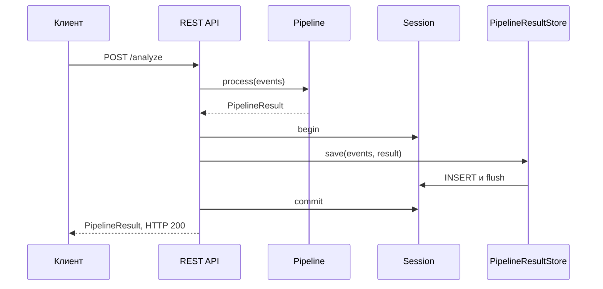

# Архитектура

Система связывает обработку файлов и нормализованных HTTP-событий общей моделью.
Её границы — локальный пакетный анализ, сохранение результатов и чтение через API.
Движки получают события и правила через публичные Python-интерфейсы.

## Модули и входы

| Модуль внутри src/security_detection_engine | Ответственность |
|---|---|
| collectors, parsers, normalization, analyzer.py | Построчное чтение SSH, разбор и нормализация |
| windows | Потоковое чтение XML, разбор 4624/4625, нормализация |
| network | Последовательное чтение PCAP, извлечение IPv4-метаданных |
| models | `SecurityEvent`, enum источников и `severity`, проверка вложенных данных |
| detection | Загрузка правил, сопоставление отдельного события и создание Alert |
| correlation | Поиск последовательностей внутри партии и создание `CorrelationAlert` |
| pipeline | Запуск обоих движков и формирование `PipelineResult` |
| storage | ORM, преобразование моделей, репозитории, транзакции |
| api | Валидация HTTP, лимит тела, зависимости и маршруты |
| rules | Встроенные правила SSH |

Компонент чтения выдаёт строки, XML-элементы или пакеты. Парсер определяет поддержку
формата и извлекает промежуточную запись. Нормализатор создаёт `SecurityEvent`
через Pydantic. Анализатор собирает события и счётчики в результат.
Структурная ошибка XML или ошибка чтения PCAP может прекратить обработку файла.
Исходный файл читается по частям. Анализатор накапливает в памяти список полученных событий.

HTTP-клиент отправляет уже нормализованные события. Промежуточный обработчик ASGI ограничивает
поток байтов до JSON-разбора, затем Pydantic проверяет AnalyzeRequest и события.
Pipeline получает валидированную партию. Файлы читаются через Python API.

## Общая модель

`SecurityEvent` содержит `event_id` UUID, `timestamp` с часовым поясом,
source из linux/windows/network, непустой `event_type`, необязательные
`severity` и host, словарь data. Severity принимает low/medium/high/critical.
UUID создаётся автоматически либо передаётся вызывающим кодом.
Поля `event_type` и `host` очищаются от краевых пробелов, пустой заданный host отклоняется.

Вложенные данные проверяются на циклы, неконечные числа в значениях и ключах
словарей, глубину контейнеров до 64 с учётом корневого. JSON-сериализация
события повторяет проверку после мутации. UUID и datetime в Python-значениях
data поддерживаются, при хранении JSON они становятся строками.
Модели изменяемы, поэтому внутренний вызывающий код отвечает за допустимость
изменений. Mapper и репозиторий корреляций повторно валидируют модели перед записью.

## Detection и Pipeline

DetectionRule выбирает `event_type` и объединяет условия через AND. Путь с точками
задаёт вложенное поле словаря. Движок формирует Alert с UUID и временем исходного события.
Условия и формат YAML описаны в [usage.md](usage.md).

Pipeline принимает экземпляры DetectionEngine и CorrelationEngine.
`process(events)` один раз собирает входные события в список и передаёт этот
список обоим движкам. Detection сохраняет входной порядок обработки,
Correlation сортирует отдельный список. Вызовы используют локальные результаты.
Состояние кандидатов между вызовами не сохраняется.

`PipelineResult` содержит `event_count`, alerts и correlation_alerts. Счётчики
`alert_count` и `correlation_alert_count` вычисляются по длинам списков и входят
в сериализованный ответ. Исключение движка прерывает process.

## Алгоритм корреляции

Сортировка по `timestamp` стабильна. При одинаковом времени сохраняется порядок
входа, который может определять возможность совпадения шагов.
Для каждого правила события группируются по кортежу значений group_by.
В ключ включается тип, поэтому True, 1 и 1.0 образуют разные группы.
Отсутствующее значение, None и сложный тип исключают событие из группировки.

В группе хранится один кандидат. События сопоставляются с очередным шагом,
между шагами допустимы посторонние события. Окно считается от первого события
до текущего. При выходе за окно кандидат сбрасывается, текущее событие пробуется
как новый старт. После полного совпадения кандидат сбрасывается.
Время алерта совпадает с концом последовательности.

Жадный выбор может пропустить допустимый поздний старт. Пример из
tests/test_correlation_engine.py — правило failed → success с окном 5 минут,
события failed на минуте 0, failed на минуте 4 и success на минуте 6.
Ранний кандидат выходит за окно, пара 4 → 6 повторно не перебирается.
Если убрать событие на минуте 0, пара обнаруживается.
Алгоритм обрабатывает одну партию, перебор всех перекрывающихся вариантов отсутствует.

## Хранение

| Таблица | Содержимое и ограничения |
|---|---|
| security_events | PK `event_id`, время, источник, тип, `severity`, host, JSONB data |
| detection_alerts | PK alert_id, поля правила и FK `event_id` |
| correlation_alerts | PK correlation_id, поля правила, интервал, JSONB group_values |
| correlation_events | PK (correlation_id, position), FK на алерт и событие, UNIQUE (correlation_id, `event_id`) |

Время хранится в PostgreSQL `timestamp` with time zone. Момент времени
сохраняется, исходное смещение при чтении может отличаться.
Проверки интервала требуют start <= end и `timestamp` == end.
Порядок UUID корреляции восстанавливается по position.
Значения групп хранятся один раз на алерт, полные события в алерты не копируются.

Репозитории принимают Session и вызывают flush без commit.
Повторный UUID вызывает IntegrityError, включая повтор идентичного объекта.
PipelineResultStore проверяет размер партии и сохраняет события, обычные
алерты и корреляционные алерты в пределах переданной транзакции.
Ссылки на уже сохранённые события допустимы. В этом случае в Store передают
только новые события, а `event_count` соответствует их числу.
Проверка семантики правил в Storage повторно не выполняется.

Ошибка внутри транзакции приводит к rollback всей партии.
Успешный ответ выдаётся после commit. При потере ответа клиент может не знать,
была ли запись завершена. Если клиент заранее назначил и сохранил `event_id`,
он может прочитать событие через `GET /events/{event_id}`. При генерации UUID
на сервере идентификатор может остаться клиенту неизвестным. Повторная отправка
без `event_id` создаёт событие с новым UUID.

## API, конфигурация и ресурсы

Фабрика `create_app` и обработчик жизненного цикла создают настройки, Pipeline, Engine и фабрику
Session один раз на процесс приложения. Подключение при импорте не открывается.
Для запроса создаётся отдельная Session, закрываемая контекстом.
При завершении приложения `Engine` освобождает пул соединений.
Правила загружаются при запуске. Для изменения правил требуется перезапуск.
Внутренние клиенты должны исключить параллельную мутацию загруженных правил.

GET использует репозитории с сортировкой по `timestamp` и UUID.
Offset-пагинация может смещаться при конкурентных вставках.
Зависимости get_session, get_pipeline и get_api_settings можно подменять
через app.dependency_overrides для тестирования.

Pydantic Settings читает окружение с префиксом SDE_.
Перечень переменных приведён в [deployment.md](deployment.md).
Автоматическая загрузка .env приложением не настроена.
Compose читает свой env-файл отдельно.

Ошибки параметров обычно дают 422, конфликт UUID — 409, отсутствующий объект
— 404, недоступность БД — 503. Readiness проверяет ревизию и наличие таблиц,
сопоставление ORM со схемой выполняется отдельным alembic check.
Ошибки файлов передаются вызывающему Python-коду, статусы повреждённых
записей учитываются анализатором. HTTP-ответы описаны в [usage.md](usage.md),
границы доверия — в [security.md](security.md).
